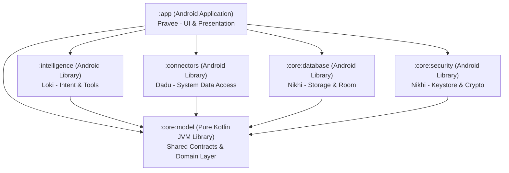
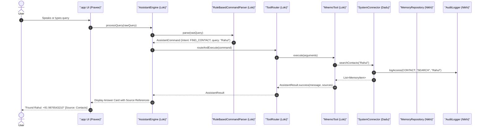

# Mnemo System Architecture

## 1. High-Level Vision

**Mnemo** is an offline-first, privacy-focused personal AI assistant for Android. It operates locally on the user's mobile device, answering questions and executing actions against authorized personal information without sending data over a network.

Every answer returned by Mnemo is verified with traceable on-device **Source References** pointing back to original local items (contacts, calendar events, messages, files).

---

## 2. Core Architectural Principles

1. **Zero Network Transmission by Design**: No `INTERNET` permission is declared in `AndroidManifest.xml` or merged from any library. The Android OS enforces network isolation at the sandbox boundary.
2. **On-Device Data Processing**: All natural language intent parsing, rule routing, and retrieval orchestration execute locally on the device CPU/NPU.
3. **Encrypted Local Storage**: Local database uses genuine SQLCipher 4.6.1 at-rest encryption (256-bit AES page encryption), protected by an envelope key management scheme rooted in the hardware-backed Android Keystore (AES-256-GCM). Plaintext SQLite upgrades are seamlessly migrated using `DatabasePlaintextMigrator`.
4. **User-Controlled Permissions**: Runtime permissions (Contacts, Calendar, Audio, Notifications) are requested just-in-time only when a specific feature requires them, and never assumed to be granted.
5. **Clean Architecture & Separation of Concerns**: Strict decoupling between Domain Contracts, Data Providers, Presentation, and Intelligence components.

---

## 3. Modular Architecture Overview

To support a 4-developer team working independently without merge conflicts, the codebase is partitioned into distinct Gradle modules and feature packages:

### Module Breakdown

| Module | Type | Owner | Responsibility |
|---|---|---|---|
| `:core:model` | Kotlin JVM Library | Shared Contract | Shared domain models (`MemoryItem`, `AssistantCommand`, `AssistantResult`), tool contracts (`MnemoTool`), connector interfaces, repository contracts, and security interfaces. Zero Android framework dependencies. |
| `:core:database` | Android Library | Nikhi | Room database schema, SQLite entities (`MemoryEntity`, `AuditLogEntity`), DAOs, FTS full-text search tables, genuine SQLCipher 4.6.1 `SupportOpenHelperFactory` integration, envelope key retrieval, and `DatabasePlaintextMigrator`. |
| `:core:security` | Android Library | Nikhi | Hardware-backed Android Keystore key management (AES-256 GCM), BiometricPrompt manager, local access audit logging, and secure data wiper. |
| `:intelligence` | Android Library | Loki | Natural language query parsing (`RuleBasedCommandParser`), tool registry & router (`DefaultToolRouter`), starter local tools (`FindContactTool`, `UpcomingEventsTool`, etc.), and retrieval orchestration. |
| `:connectors` | Android Library | Dadu | Android system data access layer: Contacts Provider, Calendar Provider, Notification Listener, Files discovery, Installed application querying, and runtime permission adapters. |
| `:app` | Android Application | Pravee | Jetpack Compose UI, Material 3 theming, Navigation (`MnemoNavHost`), DI container (`AppContainer`), `MainActivity`, `MnemoApplication`, and feature packages (`feature/bubble`, `feature/voice`, `feature/assistant`, etc.). |

---

## 4. End-to-End Request Data Flow

When a user submits a query (e.g., *"Find Rahul's phone number"* or *"Show my upcoming calendar events"*):

---

## 5. Architectural Boundaries & Team Rules

1. **Shared Contracts First**: Any modification to models in `:core:model` must be reviewed and agreed upon by all four team members.
2. **Inversion of Control**: Feature and tool implementations depend exclusively on abstract interfaces (e.g. `ContactsConnector`, `MemoryRepository`) rather than concrete platform classes.
3. **No Direct Module Cross-Dependencies**: `:intelligence` does not depend on `:connectors` directly; it relies on connector interfaces declared in `:core:model` and injected by `:app`.
4. **Thread Safety**: All I/O, database queries, and connector reads run on `Dispatchers.IO` using Kotlin Coroutines and Flows.
