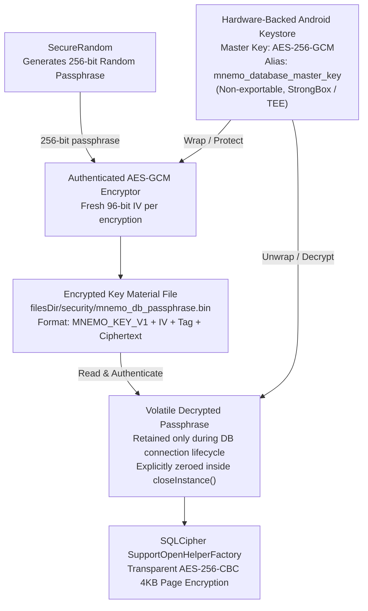

# Mnemo Database Architecture & Schema Specification

**Lead Owner:** Nikhi (Database & Security Lead)
**Module:** `:core:database`
**Storage Engine:** SQLite with Genuine SQLCipher 4.6.1 at-rest encryption via Room

---

## 1. Overview & Data Categories

Mnemo stores only local on-device indexed personal information authorized by the user.

Planned logical categories:
1. **Indexed Memory Items**: Extracted textual content from contacts, calendar, notifications, and files.
2. **Access Audit Log**: Local audit records tracking every internal query and indexing event.
3. **Full-Text Search (FTS) Index**: SQLite virtual table enabling high-speed keyword queries.
4. **Data Retention & User Settings**: User-configured retention periods and deletion schedules.

---

## 2. Complete Schema Specifications

### Table 1: `memory_items`

Stores unified indexed information from all local data connectors.

```sql
CREATE TABLE IF NOT EXISTS memory_items (
    id TEXT PRIMARY KEY NOT NULL,
    source_type TEXT NOT NULL,
    title TEXT NOT NULL,
    content TEXT NOT NULL,
    person_name TEXT,
    timestamp INTEGER NOT NULL,
    source_uri TEXT NOT NULL,
    metadata_json TEXT NOT NULL DEFAULT '{}',
    indexed_at INTEGER NOT NULL
);

CREATE INDEX IF NOT EXISTS index_memory_items_source_type ON memory_items(source_type);
CREATE INDEX IF NOT EXISTS index_memory_items_timestamp ON memory_items(timestamp);
CREATE INDEX IF NOT EXISTS index_memory_items_person_name ON memory_items(person_name);
```

#### Fields Description

| Column | Type | Constraints | Description |
|---|---|---|---|
| `id` | TEXT | PRIMARY KEY | Unique identifier (e.g. `contact_12`, `event_45`, `file_hash`) |
| `source_type` | TEXT | NOT NULL | Enum: `CONTACT`, `CALENDAR`, `MESSAGE`, `FILE`, `INSTALLED_APP` |
| `title` | TEXT | NOT NULL | Item header or subject (e.g. contact name, meeting title, filename) |
| `content` | TEXT | NOT NULL | Searchable primary text content |
| `person_name` | TEXT | NULLABLE | Associated person name for relationship queries |
| `timestamp` | INTEGER | NOT NULL | Epoch millisecond timestamp of item creation or event |
| `source_uri` | TEXT | NOT NULL | Android URI (`content://...` or `file://...`) for deep-linking |
| `metadata_json` | TEXT | NOT NULL | Serialized JSON dictionary of source-specific metadata |
| `indexed_at` | INTEGER | NOT NULL | Epoch millisecond timestamp when record was indexed |

---

### Table 2: `access_audit_log`

Non-negotiable privacy requirement: Records access events for user transparency.

```sql
CREATE TABLE IF NOT EXISTS access_audit_log (
    id TEXT PRIMARY KEY NOT NULL,
    timestamp INTEGER NOT NULL,
    source_type TEXT NOT NULL,
    action TEXT NOT NULL,
    details TEXT NOT NULL
);

CREATE INDEX IF NOT EXISTS index_access_audit_log_timestamp ON access_audit_log(timestamp);
CREATE INDEX IF NOT EXISTS index_access_audit_log_source_type ON access_audit_log(source_type);
```

#### Fields Description

| Column | Type | Description |
|---|---|---|
| `id` | TEXT | UUID for the audit event |
| `timestamp` | INTEGER | When the access occurred |
| `source_type` | TEXT | Which data source was accessed |
| `action` | TEXT | Operation: `SEARCH`, `INDEX`, `DELETE`, `READ` |
| `details` | TEXT | Query parameters or count of items retrieved |

---

### Table 3: `memory_items_fts` (Full-Text Search)

SQLite FTS4 virtual table synchronized with `memory_items`.

```sql
CREATE VIRTUAL TABLE IF NOT EXISTS memory_items_fts USING fts4(
    content="memory_items",
    title,
    content,
    person_name
);
```

#### Room FTS Synchronization Triggers
Room automatically generates triggers on `memory_items` to maintain `memory_items_fts`:
- `room_fts_content_sync_memory_items_fts_BEFORE_UPDATE`
- `room_fts_content_sync_memory_items_fts_BEFORE_DELETE`
- `room_fts_content_sync_memory_items_fts_AFTER_UPDATE`
- `room_fts_content_sync_memory_items_fts_AFTER_INSERT`

#### Full-Text Search Queries
Supported in `MemoryDao`:
```kotlin
@Query("""
    SELECT memory_items.* FROM memory_items
    JOIN memory_items_fts ON memory_items.rowid = memory_items_fts.rowid
    WHERE memory_items_fts MATCH :query
    ORDER BY memory_items.timestamp DESC
    LIMIT :limit
""")
suspend fun searchFts(query: String, limit: Int = 50): List<MemoryEntity>

@Query("SELECT COUNT(*) FROM memory_items_fts")
suspend fun countFts(): Int
```

---

## 3. Genuine SQLCipher Database Encryption Architecture

### 3.1 SQLCipher 4.6.1 Integration
Mnemo uses production-grade transparent 256-bit AES page encryption via `net.zetetic:sqlcipher-android:4.6.1` and `net.zetetic.database.sqlcipher.SupportOpenHelperFactory`. Native libraries (`libsqlcipher.so`) are packaged for `arm64-v8a`, `armeabi-v7a`, `x86`, and `x86_64`.

The native library is explicitly initialized in `MnemoDatabase.kt`:
```kotlin
System.loadLibrary("sqlcipher")
```

### 3.2 Two-Tier Envelope Key Hierarchy



1. **Hardware Root of Trust**: `AndroidKeyStoreProvider` generates an AES-256-GCM master key using authoritative alias `KeyStoreProvider.DEFAULT_KEY_ALIAS` (`mnemo_database_master_key`) residing exclusively in the Android Keystore (StrongBox Keymaster or TEE). Raw master key bytes can never be exported (`key.encoded == null`).
2. **Cryptographic Passphrase Generation**: When first launched, `KeystoreDatabaseEncryptionKeyProvider` generates a cryptographically secure 256-bit (32-byte) random passphrase using `SecureRandom`.
3. **Encrypted Passphrase Storage**: The 256-bit passphrase is encrypted with AES-256-GCM using a randomized 12-byte IV and written atomically to `context.filesDir/security/mnemo_db_passphrase.bin`.
4. **File Format (`MNEMO_KEY_V1`)**:
   - Magic Header (12 bytes): `MNEMO_KEY_V1`
   - Key Version (4 bytes): `0x00000001`
   - IV Length (4 bytes) + IV bytes (12 bytes)
   - Ciphertext Length (4 bytes) + Ciphertext + GCM Tag (48 bytes)
5. **Fail-Safe Integrity Verification**: Any file truncation, bit flipping, or corrupt header throws a structured `CorruptedKeyMaterialException`. Missing key files throw `MissingKeyMaterialException`. The database **never** falls back to plaintext SQLite or creates an unencrypted replacement on key failure.

---

## 4. Database Concurrency & Operation Lifecycle

To ensure total concurrency safety during application execution and secure wipe operations:
1. **Operation Gate (`withOperation`)**: All repository queries route through `MnemoDatabase.withOperation { ... }`.
2. **Operation Counter**: Active queries increment `activeOperations`; on completion, `activeOperations` is decremented.
3. **Wipe Coordination (`startWipe`)**:
   - Atomically sets `isWiping = true`, immediately rejecting any new database or repository operations with `IllegalStateException`.
   - Waits for already-executing queries to finish (with a 5000ms timeout) before closing connections.
4. **Wipe Mutex**: `SecureEraserImpl` uses a non-blocking `Mutex.tryLock()` to reject simultaneous wipe requests cleanly without deadlocks.
5. **Clean Restoration (`finishWipe`)**: Clears `isWiping` and resets database references in a `finally` block, ensuring failed or completed wipes never leave the application in an unrecoverable hung state.

---

## 5. Passphrase Memory Lifecycle & Android Runtime Realities

Bytecode and source inspection of `SupportOpenHelperFactory` and `net.zetetic.database.sqlcipher.SQLiteOpenHelper` reveals that SQLCipher stores the exact `ByteArray` reference passed to `SupportOpenHelperFactory` inside its helper instance (`this.mPassword`).

Room creates SQLite connections lazily when queries or transactions are executed. If the `ByteArray` is cleared at database build time, subsequent lazy connections or connection pool expansions receive all zeros, triggering decryption failure.

### Lifecycle Rules:
1. The passphrase `ByteArray` is retained in memory by `MnemoDatabase.activePassphrase` for the duration of the database instance.
2. When `MnemoDatabase.closeInstance()` is called, all SQLite connection pools and open helper instances are closed first.
3. Immediately after closing connections, `Arrays.fill(activePassphrase, 0.toByte())` zeros out the JVM heap buffer.

### JVM & OS Realities:
- **JVM Byte Array Zeroing**: Explicit zeroing overwrites the memory occupied by the retained array in the JVM heap.
- **ART Garbage Collection**: The Android Runtime (ART) garbage collector may relocate objects during compaction. Transient heap memory pages may retain historical byte copies until overwritten or reclaimed by the OS kernel.
- **Native Allocations**: SQLCipher's native engine (`libsqlcipher.so`) allocates native OpenSSL EVP structures for AES-256 page key material. `sqlite3_close()` deallocates these native structures. Total memory hygiene is achieved upon process termination.

---

## 6. Plaintext Migration Architecture & Crash-Recovery Journal

To safely upgrade pre-existing unencrypted databases to SQLCipher, `DatabasePlaintextMigrator` employs a multi-phase state machine with a durable migration state file (`mnemo_local.db.migration_state`):

### 6.1 State Machine Stages
1. **`STATE_ISOLATED`**: The plaintext database and companion files (`-wal`, `-shm`) are isolated and renamed to `.plaintext_backup`.
2. **`STATE_ENCRYPTING`**: The target SQLCipher database is initialized with Room, source schema objects are verified against `KNOWN_TABLES` (unsupported tables, views, or custom triggers throw `UnsupportedSchemaException` to prevent silent data loss), records are copied within an atomic transaction, target schema objects (indexes, FTS table, and 4 FTS triggers) are verified, and an actual FTS search query is executed.
3. **`STATE_VERIFIED`**: Record counts match, FTS virtual search is verified, reopenability with the encrypted helper succeeds, and header ciphertext inspection passes.
4. **Cleanup**: `.plaintext_backup` and companion files are overwritten with zeros via chunked 4096-byte writes with `fd.sync()` and unlinked. The state file is deleted.

### 6.2 Interrupted Migration Recovery Matrix

| Interruption Point | State Marker | Primary Copy Status | Backup Copy Status | Recovery Action | Safety Guarantee |
|---|---|---|---|---|---|
| Before Isolation | None | Plaintext intact | Does not exist | Normal migration starts | No data modified |
| After Rename | `ISOLATED` | Missing / Empty | Plaintext intact | Delete partial target, restore backup -> target | Only valid copy preserved |
| During Copy | `ENCRYPTING` | Partial / Unverified | Plaintext intact | Delete partial target, restore backup -> target | Incomplete ciphertext discarded |
| After Verification | `VERIFIED` | Encrypted verified | Plaintext awaiting wipe | Keep target, finish wiping backup | Verified target NEVER overwritten |
| During Wipe | `VERIFIED` / None | Encrypted verified | Corrupted (partially wiped) | Keep target, delete corrupted backup | Verified target NEVER deleted |
| Double Failure | Any | Corrupt | Corrupt | Halt with `IllegalStateException`, preserve files | Files preserved for forensic recovery |

Recovery **never** overwrites or deletes the only valid copy of the database.
