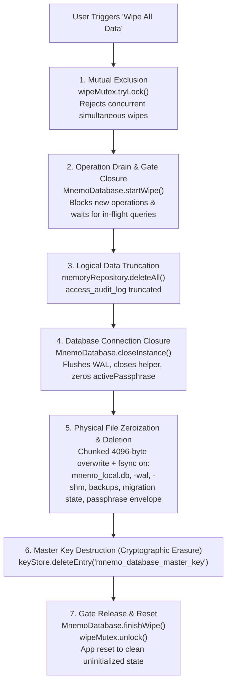

# Mnemo Privacy & Security Specification

**Privacy Tier:** Zero-Trust, Offline-First, Local-Only
**Cryptographic Standard:** AES-256 GCM Authenticated Encryption
**Hardware Root of Trust:** Android Keystore System
**Lead Owner:** Nikhi (Database & Security Lead)

---

## 1. Non-Negotiable Privacy Requirements

Mnemo is designed from first principles as an on-device personal assistant that guarantees user privacy through architectural and OS-enforced boundaries:

1. **Absolute Absence of Internet Access**:
   - `android.permission.INTERNET` is **strictly forbidden**.
   - No remote HTTP, WebSocket, gRPC, or socket-based network calls are possible.
   - Continuous Integration audits the manifest on every pull request to guarantee no indirect dependencies inject internet permission.
2. **Zero Cloud Telemetry & SDKs**:
   - Strictly no Firebase, Supabase, Google Analytics, Mixpanel, Sentry, or cloud logging.
   - No crash reports or diagnostics are transmitted externally.
3. **No Third-Party AI APIs**:
   - Zero dependencies on external cloud LLM endpoints (OpenAI, Anthropic, Gemini Cloud, etc.).
   - All query comprehension uses local rule-based parsers or local on-device neural engines (in future phases).
4. **Transparent Data Provenance**:
   - Every answer provided to the user includes a verifiable `SourceReference` citing the exact on-device data item it was generated from.
5. **Full User Sovereignty Over Data**:
   - The user controls what is indexed, how long it is retained, and can initiate instantaneous multi-layer secure erasure.

---

## 2. Cryptographic Architecture

### 2.1 Key Management via Android Keystore
- Cryptographic keys are managed by `AndroidKeyStoreProvider` using the `AndroidKeyStore` provider.
- Key specification:
  - **Algorithm:** AES (Advanced Encryption Standard).
  - **Key Size:** 256 bits.
  - **Block Mode:** GCM (Galois/Counter Mode).
  - **Padding:** None.
  - **Purposes:** `PURPOSE_ENCRYPT | PURPOSE_DECRYPT`.
  - **Authoritative Master Key Alias:** `KeyStoreProvider.DEFAULT_KEY_ALIAS` (`mnemo_database_master_key`).
- **Hardware Backing:** On supported devices (API 26+ with StrongBox or TEE), key material is generated directly in the hardware security module and cannot be extracted into application memory or copied off-device (`key.encoded == null`).
- **Backward Compatibility:** `AndroidKeyStoreProvider` and `SecureEraserImpl` recognize legacy aliases (`mnemo_master_database_key`, `mnemo_db_master_key`) for seamless fallback and complete sanitization during secure wipe.

### 2.2 Storage Encryption via SQLCipher 4.6.1
- Mnemo local SQLite storage is encrypted at rest using `net.zetetic:sqlcipher-android:4.6.1`.
- **Transparent Page Encryption:** Every 4KB SQLite database page, including WAL journals and temporary buffers, is encrypted with 256-bit AES-CBC using SQLCipher's native OpenSSL engine (`libsqlcipher.so`).
- **Two-Tier Envelope Key Management:**
  1. The hardware-backed Android Keystore holds a non-exportable master AES-256-GCM key (`mnemo_database_master_key`).
  2. `KeystoreDatabaseEncryptionKeyProvider` generates a cryptographically random 256-bit passphrase using `SecureRandom`.
  3. The passphrase is encrypted with AES-256-GCM (using a fresh 96-bit random IV) and written atomically to app-private storage: `filesDir/security/mnemo_db_passphrase.bin` under the `MNEMO_KEY_V1` binary format.
  4. At database open time, the passphrase is authenticated and decrypted in volatile memory and supplied to SQLCipher's `SupportOpenHelperFactory`. Transient buffers are wiped on error, and the key envelope is cryptographically erased upon user wipe.
- **Fail-Safe Security:**
  - If the key file is missing: throws `MissingKeyMaterialException`.
  - If the key file or header is tampered with: throws `CorruptedKeyMaterialException`.
  - The system **never** falls back to plaintext SQLite or initializes an unencrypted database on failure.

### 2.3 Passphrase Memory Lifecycle & Android Runtime Realities
- **Helper Reference Retention:** SQLCipher's `SupportOpenHelperFactory` and `SQLiteOpenHelper` retain the exact `ByteArray` reference in memory for the duration of the database connection pool. Prematurely zeroing the array corrupts lazy SQLite connections.
- **Controlled Zeroization:** Zero-filling (`Arrays.fill(activePassphrase, 0)`) is managed strictly inside `MnemoDatabase.closeInstance()` after all database connections have been closed.
- **JVM & OS Realities:** While zeroing clears the heap array reference, the ART garbage collector may compact heap pages, leaving transient historical copies until overwritten. Native OpenSSL structures are freed upon `sqlite3_close()`. Total memory sanitization is achieved upon OS process termination.

---

## 3. Data Access Auditing (`access_audit_log`)

To maintain complete transparency, all interactions with local Android data sources are logged in the `access_audit_log` table:

- **What is logged:**
  - Timestamp of access.
  - Source type accessed (`CONTACT`, `CALENDAR`, `MESSAGE`, `FILE`).
  - Action performed (`SEARCH`, `QUERY_EVENTS`, `INDEX`, `DELETE`).
  - Summary of query terms or items retrieved.
- **Where it is stored:** Exclusively in the local encrypted database.
- **User Access:** The user can inspect this log in real-time from the System Diagnostics & Privacy Screen.

---

## 4. Multi-Layer Secure Erasure Lifecycle & Concurrency

When the user initiates **Wipe All Data** in settings, `SecureEraserImpl` executes a coordinated multi-layer sanitization process:

### Concurrency Guarantees & Limitations:
- **In-flight Queries:** `startWipe(timeoutMs = 5000L)` waits for active operations to drain before closing connections or touching files. If queries do not drain within 5000ms, the wipe aborts and returns `false`.
- **New Queries:** Rejected immediately with `IllegalStateException("Database operation rejected: secure wipe in progress")`.
- **Concurrent Wipes:** `wipeMutex.tryLock()` immediately returns `false` on duplicate calls, avoiding deadlocks.
- **Flash Memory Reality (NAND / eMMC / UFS):** Flash controllers use wear leveling, bad block retirement, and out-of-place writes. Software zero-filling cannot guarantee that physical flash cells are immediately erased before TRIM/garbage collection. **Cryptographic erasure is the primary defense:** revoking the Keystore master key and overwriting the passphrase envelope renders all underlying on-disk blocks mathematically unrecoverable ciphertext.

---

## 5. Live Diagnostic Screen Accuracy

The System Diagnostics & Privacy Screen reflects live on-disk and hardware status without false claims:

| Status Badge | Condition | Accent Color | Meaning |
|---|---|---|---|
| `SQLCIPHER CONFIGURED` | Database file does not exist on disk yet | Sky Blue (`Sky400`) | Helper factory configured with Keystore passphrase; initializes upon first write |
| `DB INITIALIZED` | Database connection opened | Indigo (`Indigo500`) | Database connection was opened successfully |
| `CIPHERTEXT AT REST` | Database file exists, is non-empty, and does not match SQLite plaintext magic | Indigo (`Indigo500`) | SQLCipher transparent 256-bit AES page encryption is active; disk pages verified ciphertext |
| `ENCRYPTION UNAVAILABLE` | Database file exists but contains plaintext `SQLite format 3` signature | Red (`#EF4444`) | Security alert: unencrypted database detected; migration required |
| `RUNTIME VERIFICATION PENDING` | Instrumentation test suite has not yet run on connected device/emulator | Amber (`#F59E0B`) | On-device hardware cryptographic verification pending connected test execution |
| `RUNTIME ENCRYPTION VERIFIED` | Actual on-device instrumentation tests executed and passed | Emerald (`Emerald500`) | Only displayed after real successful runtime test execution on hardware/emulator |
